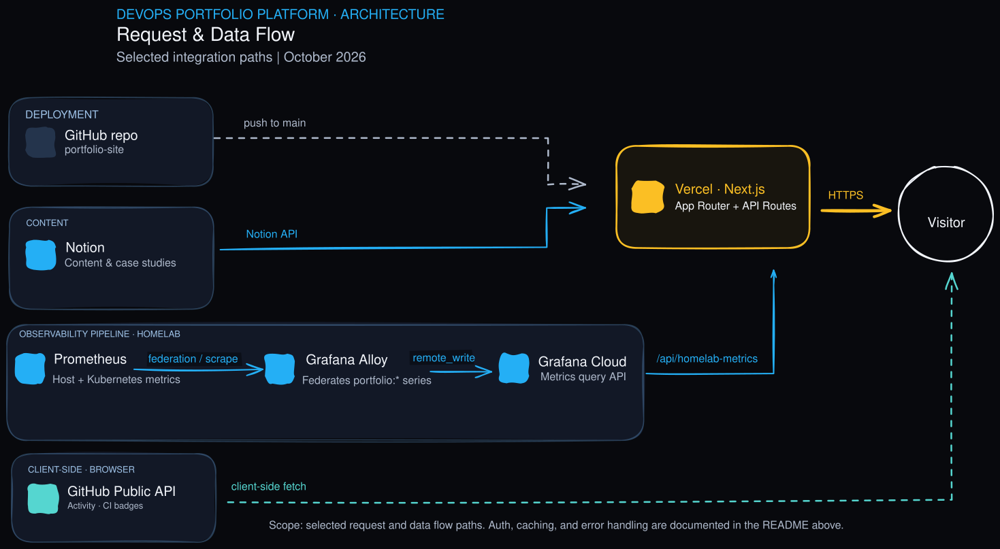
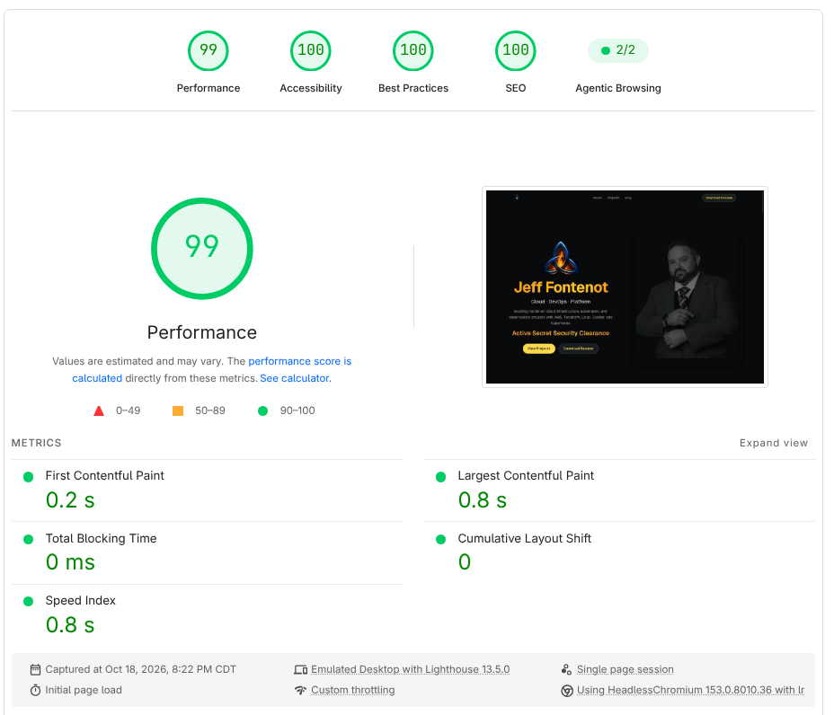
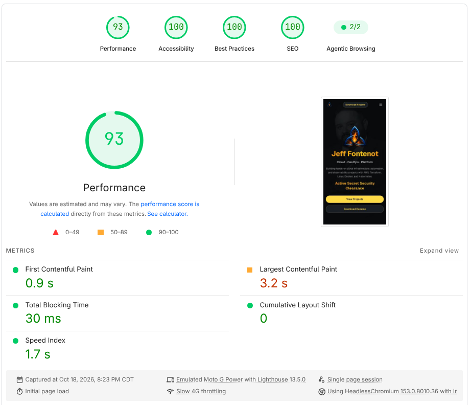

# Jeff Fontenot — Portfolio

[](docs/images/pagespeed-desktop.png) [](docs/images/pagespeed-desktop.png) [](docs/images/pagespeed-desktop.png) [](docs/images/pagespeed-desktop.png)

A Next.js cloud/DevOps portfolio and resume, built to be a living project in its own right rather than a static page. It renders a Notion-backed About page and blog, pulls live GitHub contribution data, and streams real-time Proxmox and Kubernetes telemetry from my [homelab](https://github.com/Jeff-Fontenot/homelab) straight onto the Projects section.

**Status: Operational · Active Development.** The site is in continuous production use at the live URL below. Content (About, blog, project case studies) is managed through Notion; code changes deploy through Vercel on push to `main`.

Live Site: [https://jeff.itodyssey.io](https://jeff.itodyssey.io)

---

## Architecture



[Edit the architecture diagram in Excalidraw](docs/diagrams/Porfolio-Architecture.excalidraw).

Four independent flows converge on the Next.js app and diverge back out to the visitor:

- **Deployment** (muted, dashed) — pushing to `main` triggers a Vercel build and deploy; it never touches the running request path.
- **Content** (blue) — Notion is queried server-side, with a 5-minute revalidation window on every Notion-backed route (About, blog, and each project case study).
- **Observability** (blue, multi-hop) — the only lane with more than one hop: Prometheus in the [homelab](https://github.com/Jeff-Fontenot/homelab) is federated/scraped by Grafana Alloy, Alloy `remote_write`s the sanitized `portfolio:*` series to Grafana Cloud, and `/api/homelab-metrics` retrieves them server-side — Alloy publishes, the Next.js API reads.
- **Client-side** (teal, dashed) — the GitHub contribution calendar and each project's CI badge are fetched by the visitor's browser directly from GitHub's public API, bypassing Vercel entirely; no token needed for public data.

The gold edge is the one path every visitor actually sees: Vercel assembles the response and serves it over HTTPS.

## PageSpeed Insights

Captured 2026-10-18 against the production deployment.

### Desktop — 99 Performance · 100 Accessibility · 100 Best Practices · 100 SEO



### Mobile — 93 Performance · 100 Accessibility · 100 Best Practices · 100 SEO



Scores are a point-in-time Lighthouse measurement, not a guarantee of every visitor's experience; see the [`perf: resolve Lighthouse performance and accessibility findings`](https://github.com/Jeff-Fontenot/portfolio-site/commit/83d9389) commit for the work behind the desktop pass.

## Features

- **Live homelab telemetry** — a dedicated section on the Projects page polls a server-side API route that queries Grafana Cloud for a hardcoded allowlist of sanitized `portfolio:*` metrics (host CPU/memory/disk, running containers, Prometheus scrape-target health, Kubernetes node/pod/namespace counts), publishing real infrastructure state rather than a static screenshot
- **Project cards wired to live CI/CD** — each featured project pulls its GitHub Actions status badge directly from the source repo, so build state shown here always matches the repo
- **GitHub activity feed** — a contribution calendar and top-languages breakdown rendered client-side from the public GitHub API
- **Notion-backed content** — the About page and blog are authored in Notion and rendered through a custom block renderer (headings, code blocks with syntax highlighting and copy-to-clipboard, images, callouts, lists) via `notion-to-md` and the Notion API, so new posts and case-study edits ship without a code change
- **Case study pages** — each featured project links to a dedicated `/projects/[slug]` page for deeper write-ups
- **Certifications carousel** — a Swiper-based coverflow gallery of earned certifications
- **Downloadable, ATS-friendly resume** — linked from the hero section
- **SEO and social metadata** — Open Graph and Twitter card images, a generated `sitemap.ts`/`robots.ts`, and per-route metadata
- **Motion and loading states** — Framer Motion fade-ins throughout, with `next/dynamic` used to defer client-only widgets (telemetry, GitHub activity, certifications carousel) past the initial render so they don't block first paint

## Featured Projects

The Projects section showcases four projects, each with its own repository and README:

| Project | What it is | Status |
| --- | --- | --- |
| [WakeTrail](https://github.com/it-odyssey/waketrail) | A Go CLI that records engineering activity and correlates it with infrastructure state changes into a local forensic timeline | Pre-release hardening |
| [Cloud-Native Homelab](https://github.com/Jeff-Fontenot/homelab) | The Proxmox platform — Docker Compose services, a three-node Kubernetes cluster, DNS/TLS routing, and the observability pipeline this site's telemetry card reads from | Operational |
| [Ops-Status](https://github.com/Jeff-Fontenot/ops-status) | A FastAPI monitoring service built as the workload for an end-to-end DevOps lifecycle (containerization through CI/CD to Terraform-managed AWS) | In progress |
| [Hybrid Cloud Disaster Recovery](https://github.com/Jeff-Fontenot/d342-hybrid-cloud-disaster-recovery) | A Terraform-driven DR solution that restores an on-prem Flask/PostgreSQL app into AWS from S3 backups, validated at a ~1-hour RPO and 3:55 RTO | Completed |

## Tech Stack

- **Framework:** Next.js 15 (App Router, Turbopack)
- **Language:** TypeScript
- **UI:** React 19, Tailwind CSS 4, Framer Motion, Swiper, Lucide icons
- **Content:** Notion as a headless CMS (`@notionhq/client`, `notion-to-md`), custom block renderer with Shiki syntax highlighting
- **Live data:** `react-github-calendar` for GitHub activity, a server-side API route querying Grafana Cloud's Prometheus-compatible query API for homelab telemetry
- **Deployment:** Vercel

## Getting Started

### Prerequisites

- Node.js 18+
- npm (or pnpm/yarn)

### Installation

```bash
git clone https://github.com/Jeff-Fontenot/portfolio-site.git
cd portfolio-site
npm install
```

### Environment variables

`.env.example` documents the Grafana Cloud metrics variables; copy it as a starting point and add the Notion variables below for the integrations you want to run locally:

```bash
cp .env.example .env.local
```

| Variable | Purpose |
| --- | --- |
| `NOTION_TOKEN` / `NOTION_DATABASE_ID` | Notion integration token and database ID for blog posts |
| `NOTION_PROJECTS_TOKEN` / `NOTION_PROJECTS_DATABASE_ID` | Notion integration token and database ID for project case studies |
| `NOTION_ABOUT_PAGE_ID` | Notion page rendered on the About route |
| `GRAFANA_METRICS_QUERY_URL` | Grafana Cloud Metrics instance query base URL |
| `GRAFANA_METRICS_USER` | Grafana Cloud Metrics instance ID (Basic auth username) |
| `GRAFANA_METRICS_READ_TOKEN` | Access-policy token scoped to `metrics:read` (Basic auth password) |

Without these set, the corresponding sections degrade gracefully: the telemetry card shows an honest "unavailable" state, and Notion-backed pages show a placeholder rather than failing the build.

### Run locally

```bash
npm run dev
```

### Build

```bash
npm run build
npm start
```

## Repository organization

| Path | Contents |
| --- | --- |
| `src/app/` | Routes: home, About, blog (`[slug]`), project case studies (`[slug]`), API routes, SEO files |
| `src/app/api/homelab-metrics/` | Server-side route that queries Grafana Cloud and returns the sanitized telemetry allowlist |
| `src/app/api/notion-image/` | Image proxy for Notion-hosted media |
| `src/components/` | UI components — Hero, Projects, HomelabTelemetry, GitHubActivity, Certifications, Experience, Education, Contact, NotionContent block renderer, etc. |
| `src/lib/` | Notion client, Notion block/image handling, homelab metrics fetching, YouTube helpers |
| `src/types/` | Shared TypeScript types for homelab metrics, skills, certifications |
| `public/` | Static assets — certification badges, diplomas, skill icons, resume PDF, logos |
| `docs/diagrams/` | Editable Excalidraw architecture diagram source and exported SVG |
| `docs/images/` | README screenshots, including the PageSpeed captures above |

## Roadmap

- [x] Notion-backed About page and blog
- [x] Live homelab telemetry card (host and Kubernetes metrics)
- [x] GitHub activity calendar and top-languages rail
- [x] Per-project CI/CD status badges sourced from each repo
- [x] Lighthouse performance and accessibility pass (99/100 desktop, 93/100 mobile)
- [ ] Media Channels section (component exists, currently disabled on the home page)
- [ ] Deploy Ops-Status into the homelab and link its own live status into the telemetry card
- [ ] Expand case-study pages with architecture diagrams per project

## References

- [Live site](https://jeff.itodyssey.io)
- [Cloud-Native Homelab](https://github.com/Jeff-Fontenot/homelab) — source of the live telemetry this site displays
- [WakeTrail](https://github.com/it-odyssey/waketrail)
- [Ops-Status](https://github.com/Jeff-Fontenot/ops-status)
- [Hybrid Cloud Disaster Recovery](https://github.com/Jeff-Fontenot/d342-hybrid-cloud-disaster-recovery)
- [Next.js documentation](https://nextjs.org/docs)
- [Notion API reference](https://developers.notion.com/reference/intro)
